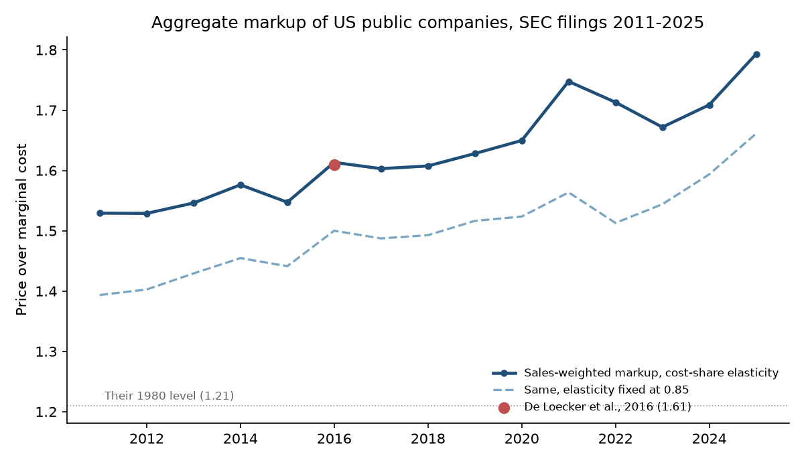
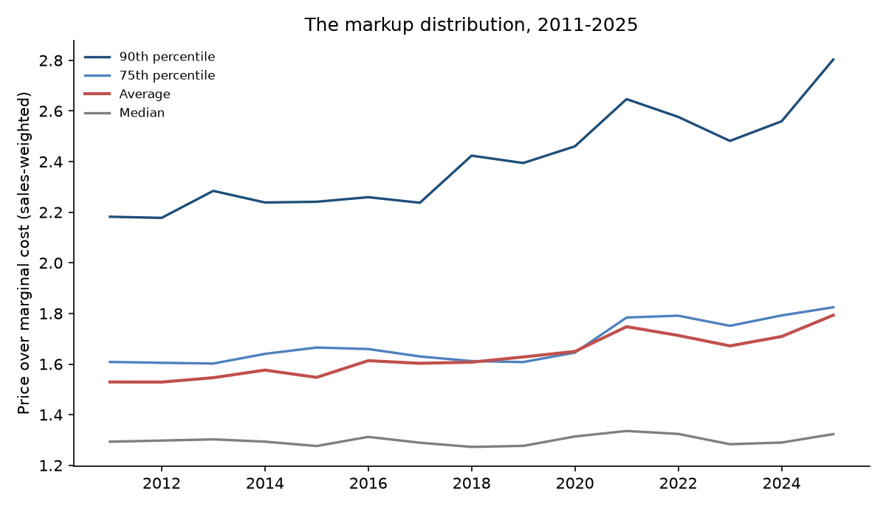
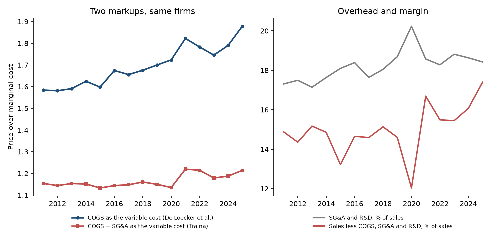

# The Markup and the Overhead

### In 2020, Jan De Loecker, Jan Eeckhout and Gabriel Unger reported that the sales-weighted average American public company had come to charge 61% more than it costs to make one more unit of what it sells. I asked again with SEC filings running to 2025.

---

In its 2025 annual report, Apple booked $416 billion of sales. By the accounting convention economists borrow
from the Compustat database, the cost of making the goods behind those sales came to $209 billion. In the year to
January 2026, Walmart sold $713 billion of groceries and everything else and spent $521 billion on what it sold. Meta Platforms sold $201
billion of advertising, and the comparable cost line was $17.6 billion. Read naively, Walmart sells at about 1.4
times cost, Apple at about 2 and Meta at about 11.

Ratios like these are at the center of a long argument among economists about market power. If companies
across the economy are pricing further and further above their costs, then shoppers pay more, workers receive a
smaller slice of what they produce, and competition is weaker than it used to be. If instead the gap between
price and the cost of goods is mostly paying for things that do not show up in that cost line, such as
engineers, salespeople, software and brand, then the same numbers describe a change in how companies spend money,
and much less about how hard they compete.

---

## Markups, and the cost of one more

A markup compares a product's price with its marginal cost, the cost of producing one more unit:

```math
\mu \equiv \frac{P}{c}
```

Here $`P`$ is the price and $`c`$ is marginal cost. A markup of 1.5 means a product that costs $1.00 to make at the
margin sells for $1.50. Prices can be observed, but marginal cost almost never appears in a company's accounts.

The approach used by De Loecker, Eeckhout and Unger, often called the production approach, gets around this with
one line of arithmetic applied to a company's income statement:

```math
\mu_{it} = \theta_{st}\,\frac{S_{it}}{\mathit{COGS}_{it}}
```

$`S_{it}`$ is the sales of company $`i`$ in year $`t`$, $`\mathit{COGS}_{it}`$ is its cost of goods sold (materials,
production labor, energy and the rest of what goes directly into the product), and $`\theta_{st}`$ is the output
elasticity of those inputs in its sector $`s`$, meaning the percentage by which output rises when those inputs rise
by 1%. Under constant returns with no other inputs $`\theta`$ would be 1. In practice it is a bit below 1 because
some output comes from machines and buildings. For Apple in 2025, with the manufacturing sector's elasticity of
0.917:

```math
\mu_{\text{Apple},2025} = 0.917 \times \frac{416.161}{209.262} = 1.824
```

The measure spans a wide range among companies people know:

| Company, 2025 | Sales | Markup by this formula |
|---|---|---|
| Walmart | $713 billion | 1.30 |
| Apple | $416 billion | 1.82 |
| Meta Platforms | $201 billion | 10.88 |

The economy-wide markup is the sales-weighted average of these company markups, so a company's influence on the
total rises with its sales.

---

## The paper and its authors

Jan De Loecker, an economist at KU Leuven in Belgium, had worked out the firm-level version of this method with
Frederic Warzynski in a 2012 paper. With Jan Eeckhout of Universitat Pompeu Fabra in Barcelona and Gabriel Unger of
Harvard University, he applied it to every American public company in Compustat from 1955 to 2016. Their article,
"The Rise of Market Power and the Macroeconomic Implications," appeared in the *Quarterly Journal of Economics* in
2020.

The method rests on one assumption about behavior, that a company chooses its flexible inputs to make a given
amount of output as cheaply as possible, taking the price of those inputs as given.
Suppose output is $`Q = F(V, K)`$, sold at price $`P`$, where $`V`$ is the flexible input bundle bought at price
$`P^V`$ and $`K`$ is capital fixed within the year at user cost $`r`$, and let $`\lambda`$ be the multiplier on the
output constraint, which equals marginal cost. Then:

```math
\begin{aligned}
\mathcal{L} &= P^V V + rK - \lambda\,(F(V,K) - Q) \\
\frac{\partial \mathcal{L}}{\partial V} = 0 &\;\Rightarrow\; P^V = \lambda\,\frac{\partial F}{\partial V} \\
\theta \equiv \frac{\partial F}{\partial V}\frac{V}{Q} &= \frac{P^V V}{\lambda Q} \\
\mu = \frac{P}{\lambda} &= \theta\,\frac{PQ}{P^V V}
\end{aligned}
```

The markup is the input's output elasticity divided by that input's share of sales, and nothing about demand or the
form of competition has to be assumed to get there.

Their headline was that the sales-weighted average markup was roughly flat from the 1950s to 1980 and then climbed
from 1.21 in 1980 to 1.61 in 2016. They reported that the median company's markup did not change, that the rise
came from the upper tail, and that about two-thirds of it came from sales shifting toward companies that already had
high markups rather than from companies raising their own. They tied the rise to the falling share of income paid to
workers and to weaker investment, and they reported that the average profit rate rose from 1% to 8% of sales, so the
higher markups were more than covering higher overhead.

The strongest objection came from James Traina, in a 2018 working paper for the Stigler Center at the University
of Chicago. Cost of goods sold leaves out selling, general and administrative expense (SG&A), which covers salespeople,
marketing, management and, in Compustat, research and development. Traina
argued that much of that spending varies with output in practice, and that once it is counted as a cost the rise in
markups is modest. De Loecker, Eeckhout and Unger addressed his measure directly in the article and reported that it
rose from 1.08 to 1.18 between 1980 and 2016. They interpret that measure as closer to a profit rate, and note
that it rose too. A separate
criticism, from Steve Bond, Arshia Hashemi, Greg Kaplan and Piotr Zoch in 2021, holds that when the elasticity is
estimated from revenue rather than physical quantities the resulting ratio carries no information about the markup,
so the level and trend of $`\theta`$ cannot be pinned down this way. The two sides agree on the arithmetic of sales over cost
of goods. They disagree on what belongs in the denominator and on what the elasticity can be known to be.

The question matters because markups feed directly into estimates of how much consumers lose to market power, into
the case for tougher antitrust enforcement and into central bankers' thinking about inflation.

---

## How I tested it

Compustat is licensed, so I rebuilt the paper's firm panel from the SEC's Financial Statement Data Sets, the
quarterly files in which the SEC publishes every number every public company tags in its filings. I used the 60
quarterly releases from mid-2011, when tagging became mandatory for small companies too, through mid-2026. They
cover fiscal years 2011 to 2025. After the paper's cleaning rules the sample holds 41,904 company-years and 6,529
companies, between 2,170 and 3,345 in any one year.

I kept the paper's rules where I could. Companies must be incorporated in the United States and carry an industry
code. Within each year I dropped the top and bottom 1% of the ratios of cost of goods to sales and of overhead to
sales, as the paper does. I measured cost of goods sold the way Compustat does, from the identity that operating
income before depreciation equals sales less cost of goods less SG&A, with R&D inside SG&A; filers' own
cost-of-revenue lines are often only part of the cost, such as AT&T's equipment costs or UnitedHealth's pharmacy
costs. Where the identity cannot be computed, I used the filer's cost-of-revenue line only if it adds up with gross
profit or operating costs. The paper's main elasticities come from production functions estimated for each sector
and year. I used the paper's own robustness method instead, the sector-year median of each company's cost share
$`\mathit{COGS}/(\mathit{COGS} + rK)`$, with $`r`$ the federal funds rate less inflation plus 12%, as in the paper,
and the paper's other check, a fixed elasticity of 0.85. Unlike the paper, I applied $`r`$ to undeflated plant and
equipment, and gross plant is imputed from net for 83% of company-years. The largest deliberate departure is that I dropped banks,
insurers and real estate companies, whose tagged cost lines are interest and claims rather than production costs.

The aggregate markup in year $`t`$ is the sales-weighted average, and the paper splits its change into pieces
(its equation 9):

```math
\begin{aligned}
M_t &= \sum_i m_{it}\,\mu_{it} \\
\Delta M_t &= \underbrace{\textstyle\sum_i m_{i,t-1}\Delta\mu_{it}}_{\text{within}}
 + \underbrace{\textstyle\sum_i \tilde\mu_{i,t-1}\Delta m_{it}}_{\text{market share}} \\
&\quad + \underbrace{\textstyle\sum_i \Delta\mu_{it}\Delta m_{it}}_{\text{cross}}
 + \text{net entry}
\end{aligned}
```

$`m_{it}`$ is the company's share of sample sales and $`\tilde\mu_{i,t-1}`$ is its markup minus last year's aggregate.
The first three sums run over companies present in both years; net entry is the share-weighted markup of entrants,
less last year's aggregate, minus the same for companies that left.
The within term is what happens if every company keeps its sales share and changes its markup; the market-share term
is what happens if markups stay put and sales move.

To test whether companies raised their own markups, I estimated a within-company trend:

```math
\ln \mu_{it} = \alpha_i + \beta\,(t - 2011) + \varepsilon_{it},
\qquad H_0:\ \beta = 0
```

$`\alpha_i`$ is a company fixed effect, $`\varepsilon_{it}`$ is the error, observations are weighted by each company's
share of sales in its year, and standard errors are clustered by company. I ran it on the company-years that also
report overhead, so that it covers the same observations as Traina's measure below, keeping companies seen in at
least two years. For the changes in the aggregates between 2011 and 2025, on the same overhead sample, I resampled
companies with replacement 500 times, holding the elasticities fixed, and report the 2.5th and 97.5th percentiles.

---

## The 2016 level matches, and the rise continued to 2025

| Year | Markup, cost-share elasticity | Markup, elasticity fixed at 0.85 | De Loecker, Eeckhout and Unger |
|---|---|---|---|
| 1980 | | | 1.21 |
| 2011 | 1.53 | 1.39 | |
| 2016 | 1.61 | 1.50 | 1.61 |
| 2021 | 1.75 | 1.56 | |
| 2025 | 1.79 | 1.66 | |

Built from public filings with different industry codes, a different cost definition and no production-function
estimates, the 2016 figure lands on the paper's 1.61. The agreement is partly luck, since the fixed elasticity gives
1.50, but the two versions rise by almost the same amount over the whole period. Writing $`M_t`$ for the aggregate
with cost-share elasticities and $`M^{0.85}_t`$ for the aggregate with $`\theta`$ fixed at 0.85:

```math
\begin{aligned}
M_{2011} &= 1.529, & M^{0.85}_{2011} &= 1.393 \\
M_{2016} &= 1.613, & M^{0.85}_{2016} &= 1.500 \\
M_{2025} &= 1.793, & M^{0.85}_{2025} &= 1.661 \\
M_{2025} - M_{2011} &= 0.264, & M^{0.85}_{2025} - M^{0.85}_{2011} &= 0.268
\end{aligned}
```



Every variant in the robustness table rises. Using net rather than imputed gross capital in the cost share, the change is 0.289.
Counting only companies whose cost of goods comes from the Compustat identity, it is 0.306. The one choice that
cuts it substantially is adding depreciation back into cost of goods, which shrinks the rise to 0.156 on the
company-years where depreciation is reported. So part of the measured rise depends on the Compustat convention of
keeping depreciation out of cost of goods. Restricting the sample to the companies present in 2011, 2016 and 2025
also shrinks it, to 0.074, which fits what the decomposition below shows about where the rise comes from.

---

## The typical company's markup barely moved

The paper's most striking claim holds in the new data. The sales-weighted median markup was 1.29 in 2011 and
1.32 in 2025, while the 90th percentile went from 2.18 to 2.80.



The decomposition says where the rise came from. Summed over 2011 to 2025:

| Component | Contribution to the change in the aggregate markup |
|---|---|
| Within companies | −0.111 |
| Market share shifts | +0.252 |
| Cross term | +0.038 |
| Net entry and exit | +0.084 |
| Total | +0.264 |

Holding sales shares fixed, companies' own markups pulled the aggregate down. All of the rise, and more, came from
sales moving toward high-markup companies. The within-company trend regression finds no change in companies' own
markups:

```math
\hat\beta = -0.0008\ (0.0009),\quad 95\%\ \text{CI}\ [-0.0025,\ 0.0009],
\quad N = 38{,}938
```

That is a change of less than a tenth of a percent a year for the same company, statistically indistinguishable from
zero. The paper found reallocation behind about two-thirds of the 1980 to 2016 rise; in this window it is behind all
of it.

The companies doing the reallocating have names everyone knows:

| Company | Markup 2011 | Markup 2025 | Share of sample sales, 2011 → 2025 | Contribution to the 0.264 rise |
|---|---|---|---|---|
| Meta Platforms | no 10-K yet | 10.88 | none → 1.3% | +0.125 |
| Mastercard | 4.00 | 21.75 | 0.1% → 0.2% | +0.042 |
| Alphabet | (Google, separate filer) | 2.71 | none → 2.7% | +0.032 |
| Nvidia | 2.18 | 3.32 | 0.04% → 1.4% | +0.026 |
| Salesforce | 6.55 | 6.34 | 0.02% → 0.3% | +0.012 |
| Apple | 1.64 | 1.82 | 1.2% → 2.8% | +0.007 |
| Amazon | 1.06 | 1.33 | 0.5% → 4.8% | −0.007 |

Meta alone accounts for nearly half of the increase; without it the aggregate rises 0.140 instead of 0.264.
Mastercard's figure is partly a product of the method. It files no cost-of-sales line, so the identity leaves as its
cost of goods whatever operating expense is not general and administrative cost or depreciation, $1.6 billion in 2011
and $1.4 billion in 2025, while its sales grew from $6.7 billion to $32.8 billion. Amazon
grew into the largest company in the sample, but its markup stayed below the average, so its growth pulled the
aggregate down slightly. Business services and software companies (SIC major group 73, which holds Meta, Alphabet,
Microsoft, Salesforce and Mastercard) went from 4.5% of sample sales to 11.7%, and their sales-weighted markup went
from 2.94 to 4.20.

---

## Counting overhead as a cost removes four-fifths of the rise

Meta's markup of 10.88 is the clearest case for Traina's objection. Its cost of goods excludes nearly all of what it
spends to run the business. In 2025 it reported $81.5 billion of SG&A and R&D against $17.6 billion of cost of goods
by the Compustat definition. Traina's measure, in the paper's notation (its equation 17), counts both:

```math
\tau_{it} = \theta^{V+X}_{st}\,\frac{S_{it}}{\mathit{COGS}_{it} + X_{it}}
```

$`X_{it}`$ is SG&A including R&D and $`\theta^{V+X}_{st}`$ is the elasticity for the combined bundle, which I took from
cost shares the same way. For Meta in 2025, with a sector elasticity of 0.981:

```math
\tau_{\text{Meta},2025} = 0.981 \times \frac{200.966}{17.559 + 81.515} = 1.99
```

On the 39,814 company-years that report overhead, the two measures diverge:

| | COGS as the only variable cost | COGS plus SG&A and R&D (Traina) |
|---|---|---|
| 2011 | 1.58 | 1.15 |
| 2016 | 1.67 | 1.14 |
| 2025 | 1.88 | 1.21 |
| Change, 2011 to 2025 | +0.294 | +0.060 |

On this sample $`M`$ is the paper's COGS markup aggregated over the same company-years, and the intervals are from
the firm bootstrap:

```math
\begin{aligned}
\Delta M &= 0.294,\quad 95\%\ \text{CI}\ [0.047,\ 0.618] \\
\Delta \tau &= 0.060,\quad 95\%\ \text{CI}\ [0.005,\ 0.127] \\
\Delta M - \Delta \tau &= 0.234,\quad 95\%\ \text{CI}\ [0.028,\ 0.525]
\end{aligned}
```

Traina's measure rises by about a fifth as much as the paper's. The ratio of the two changes is 0.21, though its
bootstrap interval runs from 0.02 to 0.56, and the gap between the two changes is unlikely to be chance. The 2016 level of 1.14 sits close to the 1.18 the paper reported for the same measure.
Overhead's share of sales barely moved over the period, from 17.3% to 18.4%, while cost of goods fell from 67.8% to
64.2% of sales. Much of the rise in the paper's measure comes from sales moving toward companies whose costs sit
mostly in overhead. Microsoft's markup of 3.05 becomes 1.80, Mastercard's 21.75 becomes 2.52, and Walmart's 1.30
becomes 1.02.



Traina's measure still rises. Within companies it drifts up by about 0.12% a year (standard error 0.07%,
p = 0.10). Operating margins after cost of goods and overhead went from 14.9% of sales to
17.4%, though the bootstrap interval for that change, from −0.2 to +5.5 points, includes zero. How much of overhead
counts as a variable cost also matters a great deal. Treating SG&A as variable but leaving R&D out, the measure rises from 1.14 to
1.32, about halfway between the paper's measure and Traina's.

---

## Why it matters

For consumers, the headline number overstates how much more they pay over production cost. The rise is real in the
accounts, but most of it reflects spending shifting toward companies such as Meta, Alphabet and Mastercard whose
products cost little to deliver once built and a great deal to build, market and run. The ordinary company's markup
did not climb, Walmart's went from 1.32 to 1.30, and Exxon's went from 1.18 to 1.20.

For workers, the reallocation finding is the more important one. When sales shift toward companies that spend a
small share of revenue on production inputs, the share of revenue paid to production workers falls even if no company
changes its pricing. That mechanism fits the paper's link to the falling labor share without requiring any company to
compete less hard.

For smaller firms, the picture is of an economy where a handful of very large, high-margin companies keep winning
sales. The median company's markup is flat, and several of the companies pulling ahead, Meta, Mastercard and
Salesforce among them, spend more on overhead than on producing what they sell.

For policy, the markup alone is too blunt an instrument to identify a market where competition has weakened. A
market-wide average can rise because a few firms grew. Antitrust has to look at those firms and their markets
directly, as the federal antitrust cases against Meta and Google have done.

---

## Limits of this study

The SEC data begin in 2011, so this study cannot see the 1980 to 2010 period in which the paper found most of the
rise, and fiscal 2025 is missing a few companies that file late. Public companies are not the economy, and the
sample shrinks from 3,165 companies in 2011 to 2,170 in 2025. Rebuilding Compustat's cost of goods from tagged figures is an approximation, and because the identity treats
every operating expense that is not SG&A, R&D or depreciation as cost of goods, one-off charges such as litigation
provisions and impairments land there too, as Mastercard's case shows. The capital used for the elasticities is mostly imputed from net plant and
equipment, and I did not estimate production functions, which is where the paper's main elasticities come from and
where Bond and coauthors locate the deepest problem. Counting all overhead as variable cost, as Traina does,
overstates the case in the other direction, since much of SG&A and R&D is spent once and serves many units. None of
this says whether any company has market power in any particular market; it says what the accounts show on average.

---

## Further reading

- [TECHNICAL.md](TECHNICAL.md): data, method, every test statistic and how to reproduce the results.
- [results/FINDINGS.md](results/FINDINGS.md): plain-English summary and every table the scripts produce.
- [METHODS_REVIEW.md](METHODS_REVIEW.md): a methods and statistical-reporting review of the original paper.
- The original paper: Jan De Loecker, Jan Eeckhout and Gabriel Unger, "The Rise of Market Power and the
  Macroeconomic Implications," *Quarterly Journal of Economics* 135(2), 2020, pp. 561–644.
- The critique tested here: James Traina, "Is Aggregate Market Power Increasing? Production Trends Using Financial
  Statements," Stigler Center Working Paper 272, 2018.
- The identification critique: Stephen Bond, Arshia Hashemi, Greg Kaplan and Piotr Zoch, "Some Unpleasant Markup
  Arithmetic: Production Function Elasticities and Their Estimation from Production Data," *Journal of Monetary
  Economics* 121, 2021.
- Data: SEC Financial Statement Data Sets, 2011 Q3 to 2026 Q2
  (https://www.sec.gov/dera/data/financial-statement-data-sets), retrieved 1 November 2026 through the Internet
  Archive's copies of those URLs; FRED series FEDFUNDS and CPIAUCSL (https://fred.stlouisfed.org), downloaded
  1 November 2026.

*Brendyn Beasley*
